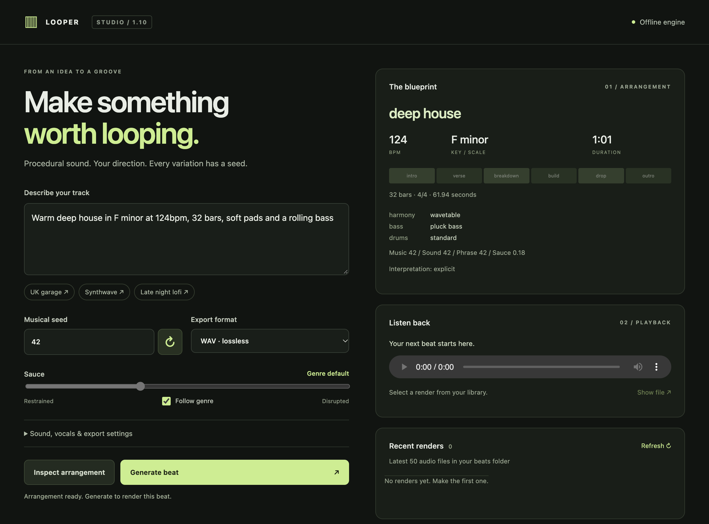

# Looper

**v2 release · Beta (`v2.0.0-beta.2`)**

Looper generates loops and tracks locally from a text prompt.

**[Download v2 beta for macOS (Apple silicon)](https://github.com/sabcodes/Looper/releases/download/v2.0.0-beta.2/Looper-macos-arm64.zip)**

## What changed in v2 beta

- **Blueprint** lets you inspect and lock a style before rendering. **Suggest direction** can preview a style from a compatible local Liquid installation and shows its progress beside the button.
- **Part editor** lets you edit notes and drum hits, solo or mute individual parts, and audition changes from the current playhead.
- **Part variations** let you reroll a soloed part with **Sauce** for sound and timing or **Rhythm** for timing alone. Both keep the part’s pitches. Part prompts can use local Liquid for unfamiliar wording, show the chosen edit, and save it in an edited copy.
- **Pedal steel** plays short pickups, sustained replies, and bends against a held note.

## Using the beta

Requires **macOS 13 or later on Apple silicon**. Unzip the download and open Looper. Choose a folder for your beats on first launch. Instrumental WAV generation works offline. MP3, FLAC, and spoken vocals require FFmpeg. Liquid features use a compatible model and runtime already installed on your Mac.

The app is ad-hoc signed and **not Apple-notarized**. This is a beta release. [Report a bug or share feedback](https://github.com/sabcodes/Looper/issues).
